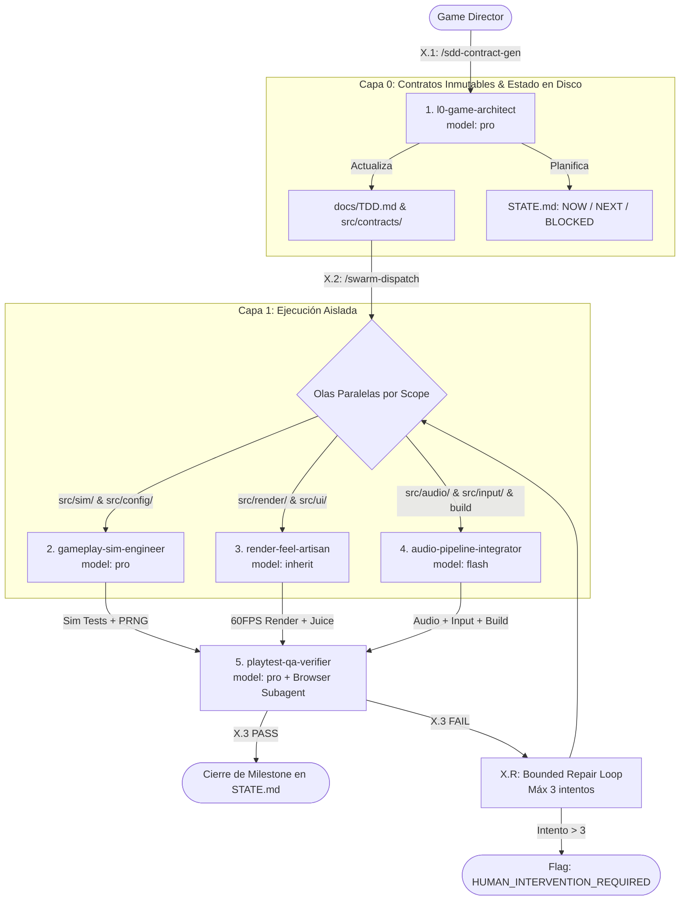

# 🎮 The Game Vanguard — Google Antigravity Multi-Agent Framework (Game Dev Edition)

Arquitectura multi-agente **Contract-First, Determinista y Zero-Trust** diseñada para desarrollar videojuegos en **Google Antigravity IDE & CLI** (TypeScript Strict + HTML5 Canvas 2D / WebGL / Three.js + WebAudio, con empaquetado offline para **Web**, **Windows `.exe` vía Tauri** y **Android `.apk` vía Capacitor**).

Optimizada para operar con ruteo de modelos **Pro / Sonnet / Flash** sin depender de Carbon ni desperdiciar cuota de tokens.

---

## ⚙️ 1. Estándar Operativo Oficial (`Protocolo X.1 / X.2 / X.3 / X.R`)

Todo videojuego se construye por Milestones (`M1`, `M2`, `M3`...) siguiendo esta cadencia estricta:

| Fase | Comando / Prompt | Qué ocurre exactamente | Gate de Salida |
| :--- | :--- | :--- | :--- |
| **`X.1`** | `/sdd-contract-gen` | `@l0-game-architect` lee `docs/GDD.md`, actualiza `docs/TDD.md`, congela interfaces en `src/contracts/` y desglosa tickets atómicos en `STATE.md`. | `typecheck` exit `0`; `0` código de implementación escrito. |
| **`X.2`** | `/swarm-dispatch` | Los builders L1 ejecutan olas en paralelo sobre *scopes* disjuntos de carpetas, sin modificar `src/contracts/`. | `typecheck` + `build` + unit tests locales `PASS`. |
| **`X.3`** | `/zero-trust-audit` | `@playtest-qa-verifier` corre higiene AST (`0` `any`, `CC <= 10`, `<= 60` líneas, `0` allocaciones en draw loop), simulación headless de 1,000+ ticks y playtest E2E en Browser Subagent. | Veredicto `[PASS]` en `STATE.md`. Si sale `[FAIL]`, pasa a `X.R`. |
| **`X.R`** | *Repair Prompt* | Reparación quirúrgica únicamente de los hallazgos `F-XXX` registrados en `BLOCKED` de `STATE.md` (máx. 3 intentos). | Re-ejecución de `X.3` hasta lograr `[PASS]`. |

---

## 🧠 2. La Célula de 5 Agentes (Model Tiering Pro / Inherit / Flash)

| Agente (`.agents/agents/`) | Modelo | Scope Exclusivo | Responsabilidad |
| :--- | :--- | :--- | :--- |
| **`l0-game-architect`** | `pro` | `docs/TDD.md`, `src/contracts/**`, `STATE.md` | Traduce el GDD en arquitectura ECS / State Machine, congela contratos y gobierna el DAG. |
| **`gameplay-sim-engineer`** | `pro` | `src/sim/**`, `src/core/**`, `src/config/**` | Núcleo 100% headless: Fixed-Timestep, reglas, física/colisiones, economía, IA/CPU (Minimax/MCTS/Flow Fields) y PRNG con semilla. |
| **`render-feel-artisan`** | `inherit` | `src/render/**`, `src/ui/**`, `src/shaders/**` | Canvas 2D / WebGL / Three.js a 60+ FPS, shaders, skins, partículas con Object Pooling, Game Feel ("Juice") y HUD/Menús. |
| **`audio-pipeline-integrator`** | `flash` | `src/audio/**`, `src/input/**`, `src/storage/**`, `build` | Audio (WebAudio/SFX), input unificado (teclado/mouse/touch/gamepad), Save/Load local, Vite, Tauri (`.exe`) y Capacitor (`.apk`). |
| **`playtest-qa-verifier`** | `pro` | `tests/**` | Auditoría AST, simulaciones headless de estrés (1,000+ ticks), validación de reglas/victoria/derrota, Frame Budget (`< 16.6ms`) y Browser Subagent E2E. |

---

## 🏛️ 3. Topología de Ejecución (Zero-Trust Game DAG)



---

## 🎯 4. Estructura Estándar de Milestones para Videojuegos

1. **Milestone 1 — Greybox & Core Loop Jugable:** Reglas completas en `src/sim/` (headless y probadas), renderizado geométrico limpio a 60 FPS y controles base. El juego ya se juega de principio a fin.
2. **Milestone 2 — Vertical Slice (IA, Game Feel, Skins/Arte y Audio):** Oponente CPU/enemigos, skins visuales/shaders, feedback visual y sonoro (hit-stop, screen shake, partículas, SFX/música) y HUD completo.
3. **Milestone 3 — Menús, Persistencia y Release Build:** Menú principal, pausa, ajustes, Save/Load local, optimización final y empaquetado offline (`.exe` Tauri para Windows/Steam o `.apk` Capacitor para Android).

---

## 🚀 5. Plantilla de Subprompts (`X.1`, `X.2`, `X.3`, `X.R`)

### Subprompt `X.1` (Arquitectura y Contratos)
```text
/sdd-contract-gen Lee `docs/GDD.md`, `docs/TDD.md`, `AGENTS.md`, `src/contracts/*` y `STATE.md`. Ejecuta la Fase 1 como `@l0-game-architect` para el **Milestone [M#]**: [descripción del alcance]. Actualiza `docs/TDD.md`, congela/extiende los contratos en `src/contracts/` sin romper milestones previos y agrega los tickets atómicos en `STATE.md`. No escribas código de implementación todavía.
```

### Subprompt `X.2` (Construcción Paralela)
```text
/swarm-dispatch Los contratos del Milestone [M#] están congelados. Ejecuta las olas de `STATE.md` respetando scopes disjuntos y sin tocar `src/contracts/`: `@gameplay-sim-engineer` (Pro) en `src/sim/` y `src/config/`, `@render-feel-artisan` (Inherit) en `src/render/` y `src/ui/`, y `@audio-pipeline-integrator` (Flash) en `src/audio/`, `src/input/`, `src/storage/` y build. Actualicen `STATE.md` al cerrar cada ticket.
```

### Subprompt `X.3` (Auditoría Zero-Trust)
```text
/zero-trust-audit Invoca a `@playtest-qa-verifier` (Pro) para auditar el Milestone [M#]: verifica higiene AST (`0` `any`, `0` `TODO`, `CC <= 10`, `<= 60` líneas/función, `0` allocaciones en draw loop), corre simulación headless de estrés (1,000+ ticks deterministas sin fugas), valida el Frame Budget (`< 16.6ms`) y ejecuta playtest E2E en Browser Subagent con `0` errores de consola. Emite `[PASS]` o `[FAIL]` en `STATE.md`.
```

### Subprompt `X.R` (Reparación Quirúrgica — solo si `X.3` arroja `FAIL`)
```text
Lee `STATE.md` (hallazgos en `BLOCKED`). No toques `src/contracts/`. Corrige únicamente los fallos listados, re-ejecuta `typecheck`, tests de simulación y verificación E2E, y actualiza `STATE.md` hasta obtener `[PASS]`.
```
