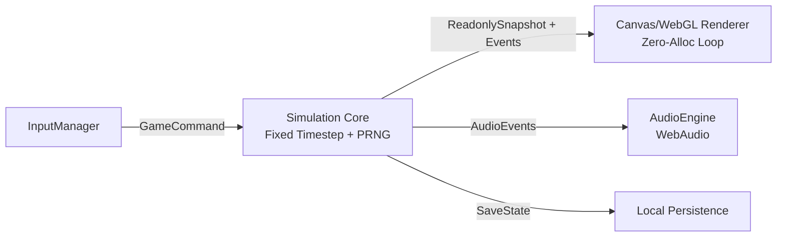

# 📐 Technical Design Document (TDD) — Game Architecture

## 1. Presupuestos de Rendimiento (SLAs)
- **Target Framerate:** `60 FPS` (`< 16.6ms` frame budget total; draw loop `< 4ms`).
- **Simulación Headless:** `1,000` ticks/turnos simulados en `< 50ms` sin incremento de heap.
- **Determinismo:** Misma `seed` + misma secuencia de `InputCommands` = estado final idéntico bit a bit.

## 2. Arquitectura del Loop (Mermaid)

## 3. Contratos Congelados (`src/contracts/`)
- `sim.ts`: Estado del juego, comandos, eventos y resultados tipados.
- `config.ts`: Esquemas data-driven de balance y skins.
- `render.ts`: Interfaz de renderizado, cámara, interpolación `alpha` y `dispose()`.
- `audio.ts` / `input.ts` / `storage.ts`: Puentes periféricos.

## 4. Estrategia de Memoria y Concurrencia
- Object Pooling para partículas, proyectiles y entidades efímeras.
- `TypedArrays` (SoA) para entidades masivas o tableros de alta frecuencia.
